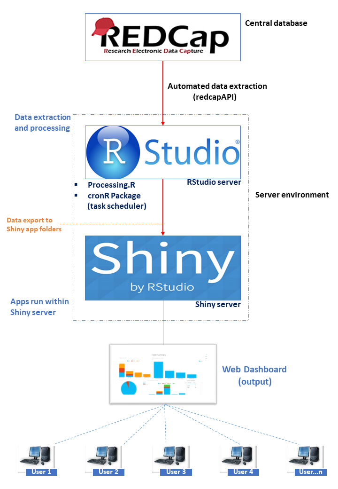

Using REDCap, RStudio Server and Shiny Server

## Introduction

Data management in multi-centre cohort studies is challenging, especially when the sites are spread across different countries and have varying technical and staffing capacity. Checking data quality, resolving data discrepancies quickly and producing progress reports all need to be accurate, systematic and timely.

The [Childhood Acute Illness and Nutrition Network (CHAIN)](https://chainnetwork.org/) is a multi-centre cohort study that recruited children from nine hospitals in Africa and South Asia. The study collected highly detailed data across many biological and social domains, captured in [Research Electronic Data Capture (REDCap)](https://www.project-redcap.org/), a web-based, metadata-driven data capture system.

In this post, I describe how we used REDCap together with the open-source R software to automate the data management workflow for CHAIN.

## The problem

The CHAIN database is large, with roughly 4,000 records and 2,000 variables. Extracting it by hand took considerable time, and every round of cleaning and reporting started with that same slow export. Sites also depended on the central coordination team to send them their outstanding data queries and progress updates, which slowed down how quickly issues were resolved.

We needed a setup where:

-   data were extracted and processed automatically, on a schedule
-   each site could see its own data queries and progress without waiting for the central team
-   access was secure and limited to study staff

## How the system works

We built the workflow from three components running in a single server environment: REDCap as the central database, [RStudio Server](https://posit.co/products/open-source/rstudio-server/) for data extraction and processing, and [Shiny Server](https://posit.co/products/open-source/shiny-server/) for the web dashboard.

{fig-align="center" width="70%"}

### 1. Automated data extraction from REDCap

REDCap provides an Application Programming Interface (API) that lets you export records programmatically. From within RStudio Server, we used the [`{redcapAPI}`](https://cran.r-project.org/package=redcapAPI) package to pull the data directly from the CHAIN REDCap project, so nobody had to download exports manually.

The examples below are simplified versions of the approach, using placeholder field names rather than the actual CHAIN variables. A connection needs the URL of your REDCap API and a project API token. Keep the token out of your scripts, for example in an `.Renviron` file on the server:

```r
library(redcapAPI)

# REDCAP_API_TOKEN is set in ~/.Renviron, never in the script itself
rcon <- redcapConnection(
  url   = "https://redcap.example.org/api/",
  token = Sys.getenv("REDCAP_API_TOKEN")
)

# export all records, with values converted to their REDCap field types
records  <- exportRecordsTyped(rcon)

# the data dictionary is useful for building checks from field metadata
metadata <- exportMetaData(rcon)
```

### 2. Processing and cleaning in RStudio Server

A processing script (`Processing.R`) takes the extracted data and runs the custom data cleaning checks and summary calculations. Its outputs include the data query listings for each site and the summaries that feed the progress reports.

Each check returns the records that fail it, with a message describing the query, so the results from all checks can be stacked into one query listing:

```r
library(dplyr)

# example checks: a missing required field and an out-of-range value
missing_weight <- records |>
  filter(is.na(weight_kg)) |>
  transmute(site, record_id, query = "Weight is missing")

implausible_muac <- records |>
  filter(muac_cm < 5 | muac_cm > 25) |>
  transmute(site, record_id, query = "MUAC outside 5-25 cm")

queries <- bind_rows(missing_weight, implausible_muac)

# recruitment summary per site for the progress reports
recruitment <- records |>
  count(site, name = "enrolled")
```

To make this hands-off, we scheduled the script with the [`{cronR}`](https://cran.r-project.org/package=cronR) package, which sets up cron jobs from R. The extraction and processing then ran automatically at set intervals. Scheduling takes two calls, run once on the server:

```r
library(cronR)

# build the command that runs Processing.R and writes a log next to it
cmd <- cron_rscript("/home/datamanager/chain/Processing.R")

# run it every day at 2 AM
cron_add(cmd, frequency = "daily", at = "2AM",
         id = "chain_processing",
         description = "Extract CHAIN data from REDCap and refresh dashboards")

cron_ls()                         # list scheduled jobs
# cron_rm(id = "chain_processing") # remove the job
```

### 3. Exporting results to the Shiny apps

At the end of each run, the processed data are exported into the folders of the Shiny applications. Because the apps read from these folders, the dashboard always shows the results of the most recent run without anyone redeploying anything.

The last lines of `Processing.R` save the outputs where the apps expect them:

```r
app_dir <- "/srv/shiny-server/chain-dashboard/data"

saveRDS(queries,     file.path(app_dir, "queries.rds"))
saveRDS(recruitment, file.path(app_dir, "recruitment.rds"))
```

Inside the Shiny app, reading the files in the `server` function means they are loaded each time a user opens the dashboard, so every session picks up the latest run:

```r
server <- function(input, output, session) {
  queries <- readRDS("data/queries.rds")
  # ... outputs built from queries
}
```

### 4. A secure web dashboard for site teams

The Shiny apps run within Shiny Server and together make up an interactive web dashboard. Study staff at the nine sites log in with authenticated credentials, and each site team can see:

-   listings of site-specific data queries to resolve
-   customised progress reports
-   real-time recruitment progress against targets

## What changed

With the automation in place, extracting and processing the data became seamless instead of a time-consuming manual step.

-   **Less reliance on the central team.** Sites follow up on their own data queries on the dashboard instead of waiting for query lists to be sent to them.
-   **Better recruitment planning.** Real-time progress information helps sites plan recruitment against their targets.
-   **Better communication and data quality.** Overall, communication with sites improved, and so did data quality, which is paramount to the success of a large cohort study.

## Conclusion

Our experience with CHAIN showed that combining REDCap and R makes data management for a large multi-site study efficient. The same setup also gives real-time, interactive monitoring of a wide range of data quality checks, which helps ensure high-quality and reliable study data.

Everything in this workflow is open source, so it can be adapted by other studies that already use REDCap, including those with limited resources.

## Watch the talk

I presented this work at the Why R? conference. You can watch the presentation on [YouTube](https://www.youtube.com/live/PbD_e5sz4P8?si=99HGccEfNv56qmWH), and the slides are available to [download](https://github.com/cmaronga/cmaronga.github.io/blob/main/my_files/automating_research_data_management.pdf).

If you have any questions or would like to set up something similar, feel free to get in touch.
