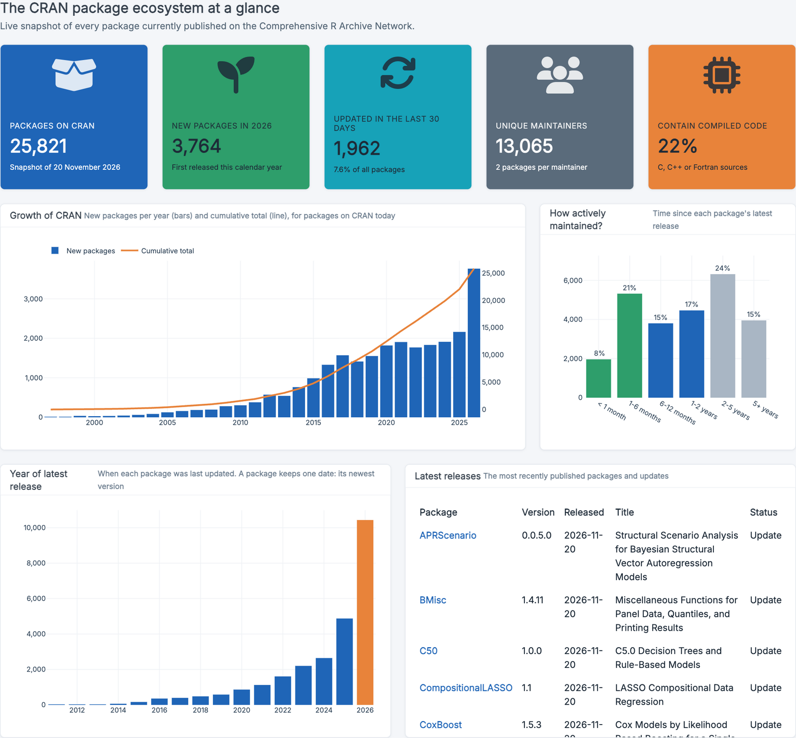
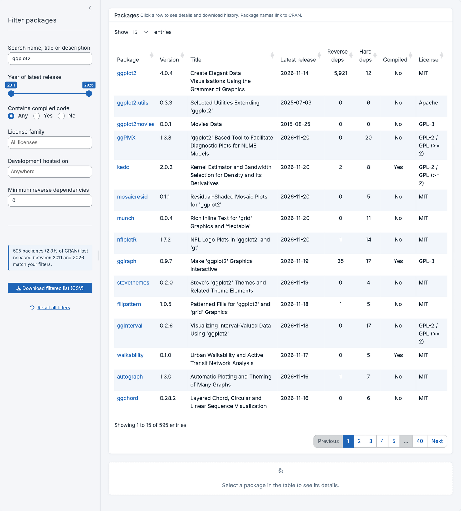
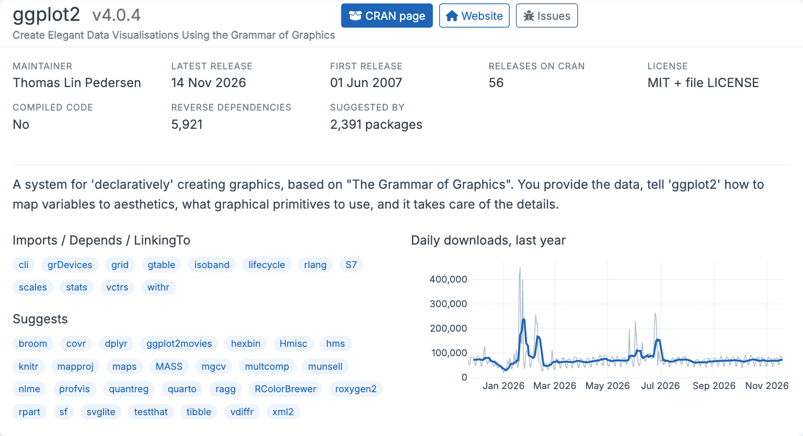
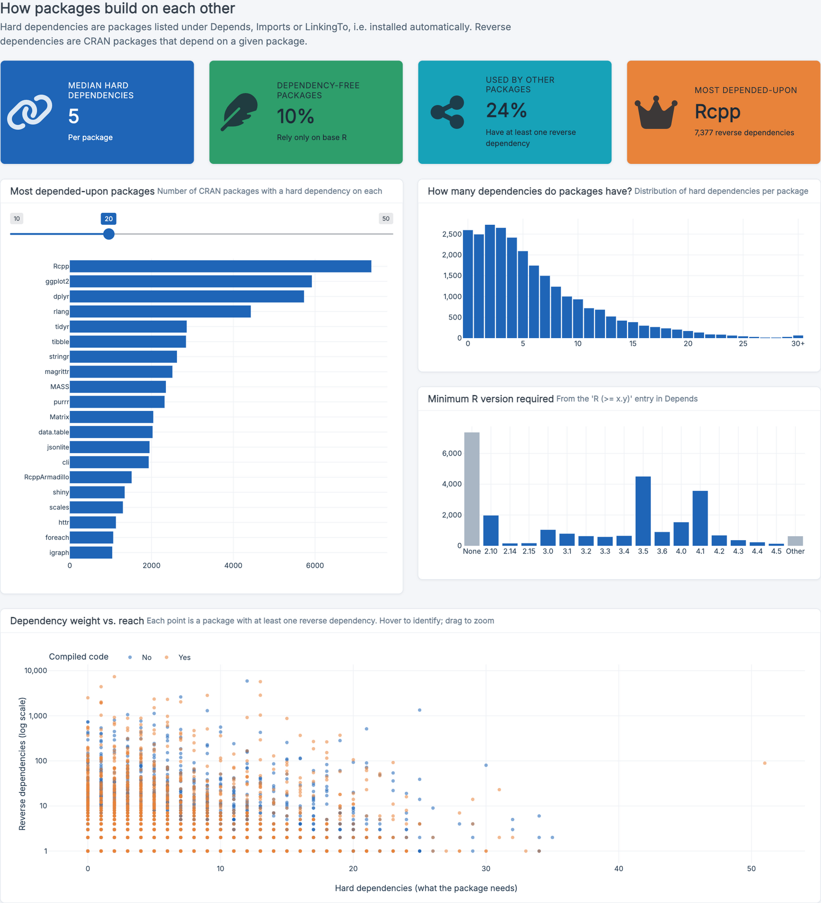
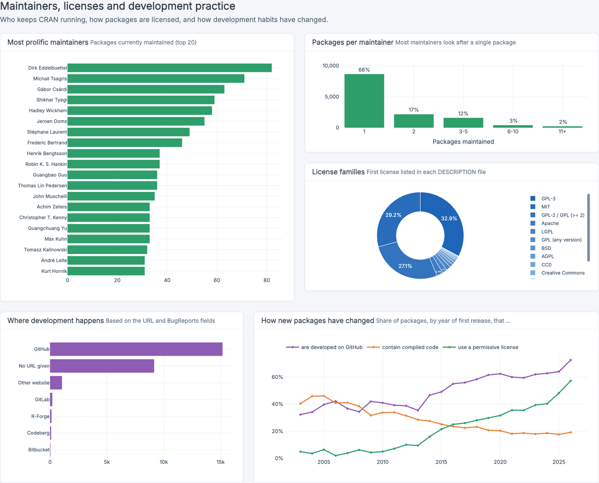
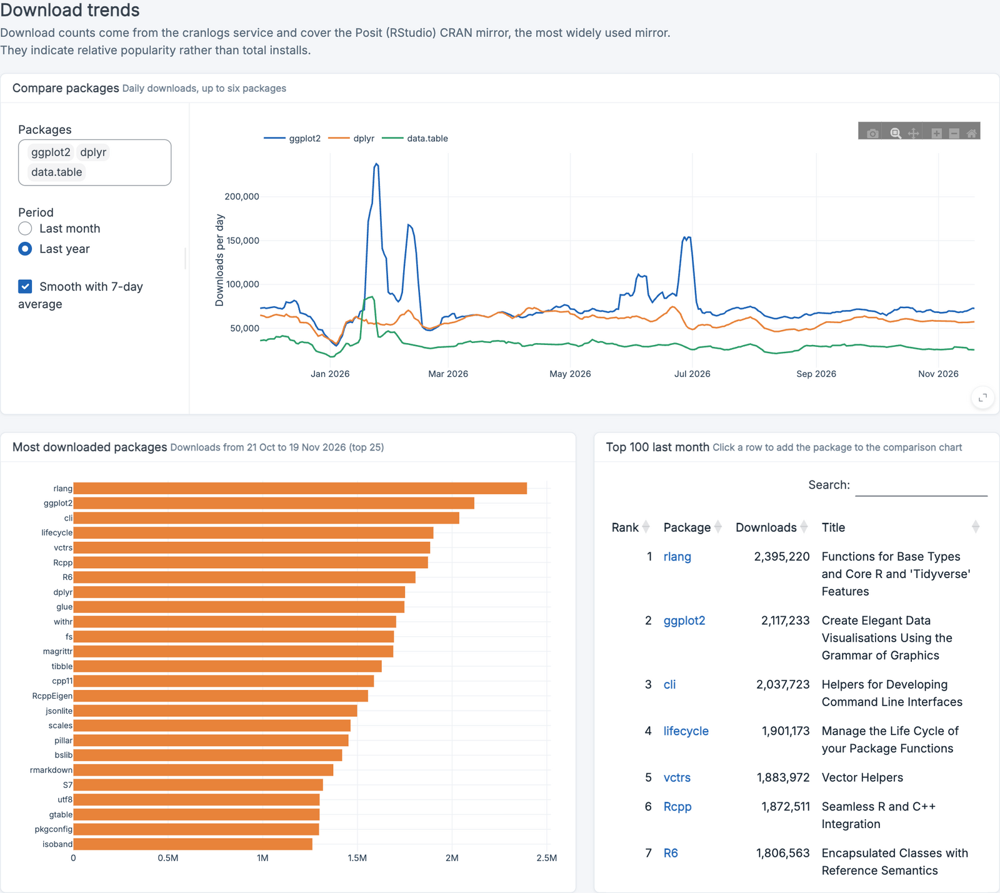

Every R user has typed this line hundreds of times:

``` r
install.packages("ggplot2")
```

You press Enter, a few lines scroll by, and a package arrives. We do it so often that we never stop to ask where it came from, or what else lives there.

It comes from **CRAN**, the Comprehensive R Archive Network. I wanted to see CRAN as a whole, not one package at a time, so I built **CRAN Explorer**, a Shiny dashboard that maps all of it.

The easiest way to explain the app is to pretend CRAN is a city. Put on comfortable shoes. The tour starts now.

::: callout-tip
## Try it yourself

The app is live at **[https://chris-maronga.shinyapps.io/CRANPackagesExplorer/](https://chris-maronga.shinyapps.io/CRANPackagesExplorer/)**. The numbers and screenshots in this post come from the 20 November 2026 snapshot. The live app refreshes its data every day, so you'll see slightly different figures.
:::

## Stop 1: The view from the hill (Overview tab)

Every good city tour starts on a hill, where you can see the whole skyline. That is the **Overview** tab.

{fig-alt="Screenshot of the CRAN Explorer Overview tab with five coloured value boxes, a growth chart, a freshness bar chart and a table of the latest releases."}

From up here, CRAN City has:

| What you see                | How many  | In city terms                                                 |
|-----------------------------|-----------|---------------------------------------------------------------|
| Packages on CRAN            | 25,821    | Houses in the city                                            |
| New packages in 2026        | 3,764     | Houses built this year                                        |
| Updated in the last 30 days | 1,962     | Houses that had work done this month (7.6%)                   |
| Unique maintainers          | 13,065    | Homeowners, about 2 houses each on average                    |
| Contain compiled code       | 22%       | Houses with an engine room: C, C++ or Fortran under the floor |

That last one deserves a word. Most packages are written in R alone. About one in five also carry code in C, C++ or Fortran, usually for speed. That code must be *compiled* (translated into machine instructions) before it runs. It is the engine room of the house: invisible from the street, but the reason some houses move so fast.

### How fast has the city grown?

The **Growth of CRAN** chart shows how many of today's houses were first built each year (the bars) and the running total (the orange line). In 2015, 988 of today's packages were first released. In 2025 it was 2,162.

There is a catch, and it is a ghost story. CRAN City only shows houses still standing. A package released in 2012 and removed in 2018 has vanished from the map. So older years look smaller than they really were, because their ghosts aren't counted.

### When was the paint last fresh?

Walk down any street and you'll see houses with fresh paint and houses with peeling paint. The **How actively maintained?** chart sorts every package by the time since its latest release:

| Last updated     | Packages | Share |
|------------------|---------:|------:|
| Under a month    |    1,962 |    8% |
| 1–6 months       |    5,321 |   21% |
| 6–12 months      |    3,803 |   15% |
| 1–2 years        |    4,463 |   17% |
| 2–5 years        |    6,318 |   24% |
| More than 5 years |    3,954 |   15% |

So 57% of houses haven't had a new coat of paint in over a year. That sounds alarming, but it often isn't. Some houses are small, solid and finished. A package that does one job well may simply need no changes.

Next to it, the **Latest releases** table is the city's notice board: the 50 most recent arrivals. "New" means a brand-new house; "Update" means renovation work on an existing one.

## Stop 2: The address book (Package Explorer tab)

Every city needs a directory. The **Package Explorer** is a searchable table of all 25,821 houses, with filters down the side:

-   **Search** looks through names, titles and descriptions. Type `bayesian` and you get every house with Bayesian in its story.
-   **Year of latest release** keeps only houses last renovated in the years you choose.
-   **Contains compiled code** shows only houses with (or without) an engine room.
-   **Licence family** filters by the house rules (more on those at Stop 4).
-   **Development hosted on** filters by where the builders work: GitHub, GitLab and so on.
-   **Minimum reverse dependencies** is my favourite. Set it to 100 and the city shrinks to the buildings everyone else relies on.

{fig-alt="Screenshot of the Package Explorer tab with the filter sidebar on the left and a table of packages matching the search ggplot2."}

Click any row and a **detail card** opens: the house's full profile. It shows the owner (maintainer), when it was first built and last renovated, how many versions it has had, which packages it needs, and a year of daily downloads. A package with 40 releases over 10 years is a house someone clearly loves. One with a single release from 2015 may be standing empty.

{fig-alt="Screenshot of the ggplot2 detail card showing maintainer, release dates, licence, reverse dependencies, dependency badges and a chart of daily downloads over the last year."}

When you've found what you need, **Download filtered list (CSV)** takes the results home with you.

## Stop 3: The power grid (Dependencies tab)

Here the tour gets interesting. Houses in CRAN City aren't independent. They plug into each other.

When a package needs another package to work, that's a **dependency**. They are listed in a package's `DESCRIPTION` file under four headings:

| Field     | City version                                                          | Installed automatically? |
|-----------|-----------------------------------------------------------------------|--------------------------|
| Depends   | The power line, switched on when you move in (`library()`)            | Yes                      |
| Imports   | Cables inside the walls: needed, but you never see them               | Yes                      |
| LinkingTo | The engine room's wiring, needed only to compile C/C++ code           | Yes                      |
| Suggests  | A spare room for guests: nice for examples and tests, but optional    | No                       |

The first three are **hard dependencies**: the cables you can't cut. The median package has **5** of them. Only **10%** of houses run entirely off-grid, needing nothing beyond base R.

Now flip the view around. If your house draws power from a station, your house is a **reverse dependency** of that station. Count how many houses plug into each package and you find the city's power stations:

| Rank | Package  | Packages that depend on it |
|-----:|----------|---------------------------:|
|    1 | Rcpp     |                      7,377 |
|    2 | ggplot2  |                      5,921 |
|    3 | dplyr    |                      5,730 |
|    4 | rlang    |                      4,428 |
|    5 | tidyr    |                      2,860 |

**Rcpp** is the city's biggest power station. It lets R packages call fast C++ code, and more than 7,000 packages are wired into it. If Rcpp went dark, a big part of CRAN City would flicker. Only **24%** of packages power anything else; the other 76% are houses at the end of the line.

Two more charts on this stop:

-   **Minimum R version required** is like the building code. 7,362 packages set no minimum. Among those that do, the most common are R 3.5 (4,499 packages) and R 4.1 (3,565). Those aren't random: R 3.5 changed how R saves data files, and R 4.1 introduced the native pipe `|>`. Use either and you must require that version.
-   **Dependency weight vs. reach** puts every power station on one map. Left to right is how much a package needs (its *weight*). Bottom to top is how many packages need it (its *reach*). The top-left corner holds the city's treasures: packages that many others rely on but that need very little themselves. The vertical axis is on a log scale, where each gridline is ten times the one below, so tiny cottages and giant stations fit on the same chart.

{fig-alt="Screenshot of the Dependencies tab with four value boxes, a bar chart of the most depended-upon packages led by Rcpp, a histogram of dependency counts, a bar chart of minimum R versions and a scatter plot of hard dependencies against reverse dependencies."}

## Stop 4: Meet the residents (Community tab)

A city is its people. The **Community** tab introduces the homeowners.

{fig-alt="Screenshot of the Community tab with a bar chart of the top 20 maintainers, a bar chart of packages per maintainer, a donut chart of licence families, a bar chart of code hosts and a line chart of trends over time."}

The busiest maintainers look after an astonishing number of packages: Dirk Eddelbuettel (82), Michail Tsagris (71), Gábor Csárdi (63), Shikhar Tyagi (59) and Hadley Wickham (58). But they are the exception. **Two in three maintainers (66%) look after exactly one package.** CRAN City wasn't built by a few big developers. It was built by thousands of people who each put up one house.

### The house rules

Every house has rules about what visitors may do with it: its **licence**. Three families cover 89% of the city:

-   **GPL-3** (32.9%) and **GPL-2** (27.1%): *copyleft* rules. You can borrow anything, but whatever you build with it must follow the same rules. R itself is GPL, so this is the city's oldest tradition.
-   **MIT** (29.2%): a *permissive* rule. Borrow it, change it, use it almost any way you like; just keep the original name plate on the door.

### Where the builders work

The **Where development happens** chart checks each package's links to see where its code lives. GitHub wins easily at 58.7%. Another 35.4% list no website at all. Their builders work behind closed doors.

### How the neighbourhoods have changed

My favourite chart in the app tracks how *new* houses have changed over the years. Compare packages first released in 2012 with those from 2025:

| New packages that ...         | 2012 | 2025 |
|-------------------------------|-----:|-----:|
| are developed on GitHub       |  39% |  64% |
| contain compiled code         |  31% |  18% |
| use a permissive licence      |  10% |  48% |

The new neighbourhoods look different. More builders work in the open on GitHub, fewer houses need an engine room, and permissive rules have gone from rare to nearly half.

## Stop 5: Rush hour (Downloads tab)

The last stop is the busiest: the city's traffic counters.

The **Downloads** tab uses the [cranlogs](https://cranlogs.r-pkg.org) service, which counts daily downloads from Posit's CRAN mirror. One warning before we look: that is one road into the city, not all of them, and some of the traffic is robots (build servers and Docker images installing packages automatically). Read the numbers as *which streets are busier*, not as a census of people.

-   **Compare packages** puts up to six packages side by side. Turn on the **7-day average** to smooth out the weekly rhythm: traffic drops every weekend, because R users rest too.
-   **Most downloaded packages** shows the 25 busiest streets of the last month, with the full top 100 in a table. Click any row to add that package to the comparison chart.

{fig-alt="Screenshot of the Downloads tab with a line chart comparing daily downloads of ggplot2, dplyr and data.table over the last year, a bar chart of the 25 most downloaded packages and a table of the top 100."}

You'll notice packages like rlang, cli and vctrs near the top. Few people install them on purpose. They are the pavements under the busy streets: every visit to ggplot2 or dplyr brings them along.

## The fine print

Every tour guide should be honest about what the map leaves out:

-   Only houses standing today are counted; removed packages are the city's ghosts.
-   First-release dates come from CRAN's archive timestamps and are approximate for very old packages. The oldest house on the map dates from December 1997.
-   When a package offers a choice of licences, only the first is counted.
-   A maintainer who writes their name two ways is counted as two people.
-   The data is refreshed every 24 hours, so the map is never more than a day old.

## How the city map is drawn

For the curious, CRAN Explorer is plain R across the classic Shiny files: `global.R` downloads and prepares the data, `ui.R` lays out the pages with {bslib}, and `server.R` draws the charts with {plotly} and the tables with {DT}.

The data comes from three public sources, with no web scraping:

1.  `tools::CRAN_package_db()`: the `DESCRIPTION` file of every package, plus CRAN's own reverse-dependency counts.
2.  CRAN's archive index (`src/contrib/Meta/archive.rds`): every old version of every package, used for first-release dates and release counts.
3.  The [cranlogs API](https://cranlogs.r-pkg.org): daily download counts.

The first start downloads everything (about a minute) and caches it, so later visits are instant.

## End of the tour

CRAN City is 25,821 houses built by more than 13,000 people, most of whom built just one. It runs on a handful of power stations like Rcpp, ggplot2 and dplyr, and it gets busier every year. The next time you type `install.packages()`, remember you're borrowing a house from one of those builders.

[Go and explore](https://chris-maronga.shinyapps.io/CRANPackagesExplorer/): look up a package you use every day, see how many others plug into it, and race it against its rivals on the Downloads tab. If you find something interesting, or a bug, leave a comment below. I'd love to hear what you discover.
